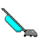

# Kirby Pet &nbsp;

 - A Neko98 inspired app and screensaver with a vacuum cleaner instead of a cat.

## Motivation

Because I [restore vintage vacuum cleaners](https://thorium.rocks/kirby_history/) and wanted a Neko pet lookalike
with a vacuum instead, expanded to a screensaver as well.

I maintain [Neko-ng](https://github.com/Alex313031/neko-ng), an up to date fork of [Neko98](https://github.com/neozeed/neko98), part of the [Neko desktop pet lineage](https://en.wikipedia.org/wiki/Neko_(software)).

## Building

### With GN/Ninja
This uses the same build system as [Chromium](https://www.chromium.org):
[GN](https://gn.googlesource.com/gn/+/refs/heads/main/README.md) + [Ninja](https://ninja-build.org/).

I have made a minimal, modified version configured specifically for compiling Win32 programs
for legacy Windows called [gn-legacy](https://github.com/Alex313031/gn-legacy).  
It can be used on Windows 7+ or Linux. (Unlike the regular MinGW method above, gn.exe does not work on Windows XP/Vista.)

Really, it is a meta-build system. GN stands for "Generate Ninja" and can use __BUILD.gn__ files to
generate `.ninja` files. These are used by Ninja (the actual build system), to run the commands to compile it.  
The compiler itself is dependant on the host platform:  
On Linux, a special MinGW build I compiled on Ubuntu 24.04 to support legacy Windows and use static linkage is used.
On Windows, it simply uses an extracted toolchain from win32-devkit mentioned above.

## Resources

Charles Petzold - [Programming Windows 5th Ed.](https://www.charlespetzold.com/books/) - Definitive book on the Win32 API.
